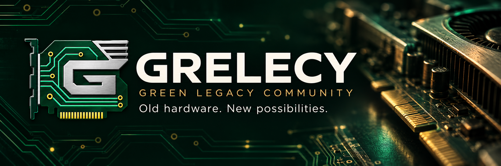

<!-- SPDX-License-Identifier: CC-BY-4.0 -->

**Exploring a future for legacy graphics hardware.**

An independent community bringing together GPU owners, enthusiasts, testers, and developers to explore how older graphics cards can remain useful on Windows, starting with NVIDIA Kepler, Maxwell, and Pascal GPUs.

[Get involved](https://github.com/FaipL/Grelecy/issues/new?template=01-join.yml) · [Share a compatibility issue](https://github.com/FaipL/Grelecy/issues/new?template=02-compatibility.yml) · [Contributing guide](CONTRIBUTING.md)

---

> **Project stage: community formation and research.** We are gathering people, hardware experience, and reproducible problems. GRELECY does not currently provide drivers, patches, or a supported software release. Technical goals will be defined with contributors.

## Why GRELECY exists

Working hardware can still have value after official support ends. Software requirements change, compatibility becomes harder to maintain, and practical knowledge can become scattered across forums and individual experiments.

GRELECY aims to bring that knowledge and those people together. Our starting point is older NVIDIA GeForce graphics hardware on Windows. Our broader ambition is to help extend the useful life of computer hardware through shared knowledge, open research, and community-developed software where feasible.

**GRE** comes from **Green**, **LE** from **Legacy**, and **CY** from **Community**.

## Our initial focus

| Area | Starting scope |
| --- | --- |
| Hardware | Older NVIDIA GeForce graphics cards |
| Initial architectures | Kepler-based models in the GTX 600/700 families, Maxwell-based GTX 900 models, and Pascal-based GeForce GTX 10 series models |
| Operating system | Windows; exact version and build recorded for each report |
| First work | Gather volunteers, inventory available hardware, document problems, and assess feasibility |
| Technical commitments | To be agreed after reviewing evidence and available contributor skills |

**A product series is not an architecture.** GTX 600/700 branding includes models outside Kepler. Please identify the exact card, desktop or laptop variant, and architecture where known. A model's presence in the starting scope is an invitation to contribute evidence, not a guarantee of support.

**Kepler, Maxwell, and Pascal are all part of the initial community scope.** Pascal owners are welcome from the start, including GTX 1050 / 1050 Ti, GTX 1060, GTX 1070 / 1070 Ti, and GTX 1080 / 1080 Ti owners. These examples are not an exhaustive hardware whitelist. Desktop and laptop variants can be reported with their exact model and architecture.

This recruitment scope does not set an implementation order or promise a driver for each generation. The community will choose technical priorities from the evidence, hardware, and skills available. Other GPUs can provide useful comparisons; further scope changes will be discussed with contributors.

See [Project scope](docs/PROJECT_SCOPE.md) for the current brief and [Public recruitment texts](docs/RECRUITMENT.md) for the English and French presentation drafts.

## What we could explore together

The following are research directions, not announced features or delivery commitments:

- **Compatibility research:** document reproducible issues involving particular applications, Windows builds, and driver versions.
- **Hardware and driver knowledge:** build a clear, sourced record of models, architectures, known limitations, and existing approaches.
- **Diagnostic tools:** investigate whether original tools could make troubleshooting and reporting easier.
- **Targeted fixes or workarounds:** assess specific, achievable improvements when technical feasibility and distribution rights are understood.
- **Alternative approaches:** evaluate proposals from contributors, including their dependencies, limitations, and maintenance cost.

A new driver is one possible subject for research. It is not a prerequisite for GRELECY to be useful, and no new driver, security update, modern API support, or performance improvement is promised.

## Community first

We will begin with people and evidence, then choose work that the community has the skills and hardware to pursue.

| Step | Intended outcome |
| --- | --- |
| 1. Gather contributors | Identify interested owners, testers, developers, and researchers |
| 2. Map hardware and problems | Record available GPUs and reproducible compatibility reports |
| 3. Assess proposals | Compare feasibility, existing work, rights, and maintenance needs |
| 4. Agree on a first objective | Choose a bounded problem with a clear way to evaluate success |
| 5. Develop and document | Work openly, record results, and explain limitations |

These are working stages, not a dated release roadmap.

## Get involved

You do not need to write code to contribute.

| You can help as a… | Useful contributions |
| --- | --- |
| GPU owner or tester | Identify your hardware, describe your setup, and reproduce documented issues |
| Developer | Bring C/C++, Windows driver, graphics API, tooling, or debugging experience |
| Researcher | Investigate GPU architectures, existing projects, and compatibility constraints |
| Documentation contributor | Turn scattered findings into clear, sourced, reproducible documentation |
| Community contributor | Welcome participants, organize information, and help with translation |

### Start here

1. **[Introduce yourself](https://github.com/FaipL/Grelecy/issues/new?template=01-join.yml)** with your hardware, interests, and any skills you would like to contribute.
2. **[Report a compatibility problem](https://github.com/FaipL/Grelecy/issues/new?template=02-compatibility.yml)** with your exact GPU, Windows build, driver version, and reproduction steps.
3. **[Propose a research direction](https://github.com/FaipL/Grelecy/issues/new?template=03-proposal.yml)** with a bounded question, relevant references, and a possible way to test it.
4. Read **[CONTRIBUTING.md](CONTRIBUTING.md)** before opening a pull request.

English is the main language for shared project documentation. Contributions and questions in French are also welcome; we can work toward an English summary together.

## How decisions will work

Proposals and findings should be discussed publicly in this repository so that the reasoning remains accessible. We want contributors to help define the technical priorities.

During this initial stage, repository maintenance and merge decisions are handled by [FaipL](https://github.com/FaipL). A more formal governance model can be discussed as the community takes shape. A suggestion, issue, or vote does not automatically become a project commitment.

## Project home

This repository is the starting point for GRELECY's public presentation, contribution guidance, and initial research coordination. Use [GitHub Issues](https://github.com/FaipL/Grelecy/issues) for introductions, reports, and proposals.

Additional community channels will be linked here when they are available.

### Project website

The repository includes a static project website in French and English, using the existing GRELECY visual identity. See [the website guide](website/README.md) for editing, local preview, and GitHub Pages deployment.

## Independence and third-party software

GRELECY is independent and is **not affiliated with, sponsored by, or endorsed by NVIDIA**. NVIDIA, GeForce, and other product names belong to their respective owners.

Our open-source licenses apply only to material we have the right to license. They do not grant rights over NVIDIA drivers, firmware, or other third-party software. Please link to legitimate upstream sources rather than uploading third-party binaries or code without permission.

## Licensing

| Material | Terms |
| --- | --- |
| Original software in this repository, unless explicitly identified otherwise | [Mozilla Public License 2.0](LICENSE) |
| Original documentation and the text of contribution templates, unless explicitly identified otherwise | [Creative Commons Attribution 4.0 International](LICENSES/CC-BY-4.0.txt) |
| GRELECY name, logos, and visual identity | Separate [brand policy](BRANDING.md) |
| Third-party material | Its own applicable license and notices |

See **[LICENSING.md](LICENSING.md)** for the exact scope, attribution guidance, and contribution rules. The software source currently consists of the static project website and its build tools. Licenses for future repositories or driver projects will be decided explicitly for those projects.

---

**GRELECY — Green Legacy Community**  
Shared knowledge. Collaborative research. Longer hardware life.

